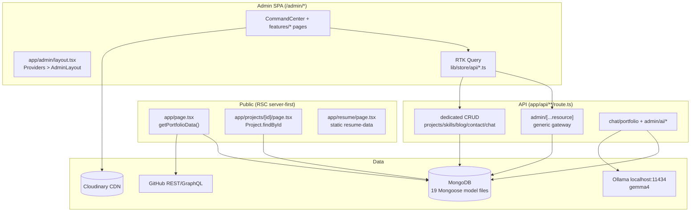
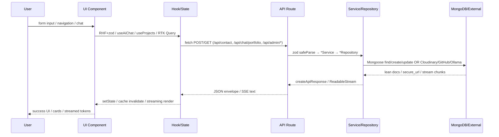
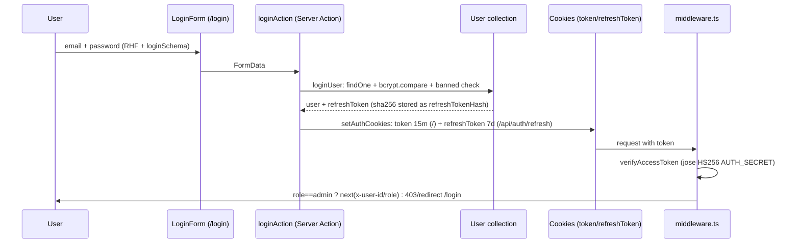
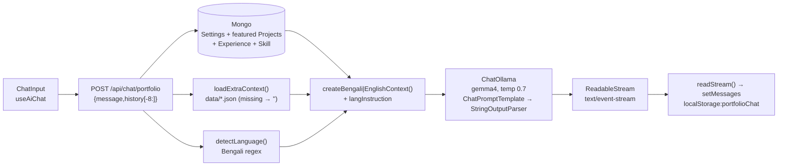
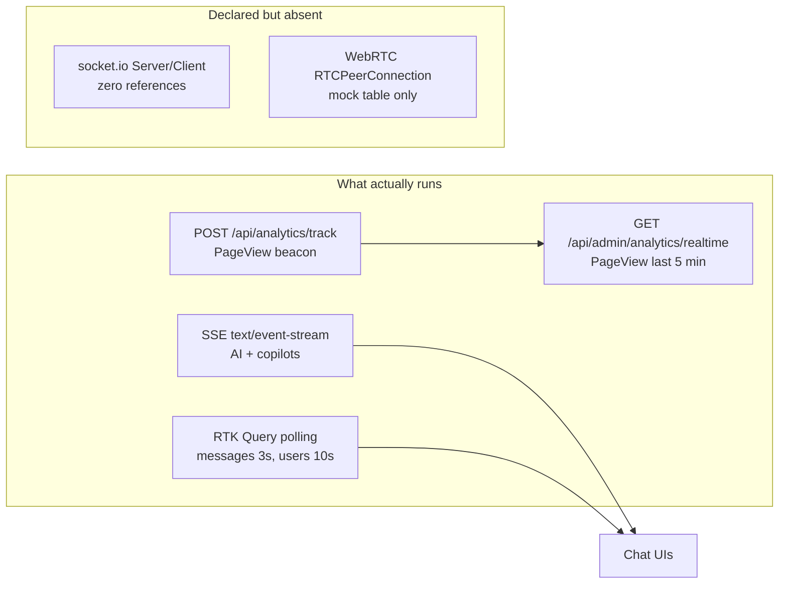

# Soruj Mahmud — AI Engineer & Full-Stack Developer Portfolio + Admin CMS

## Overview

Production-grade portfolio and content management platform for Soruj Mahmud (`lib/constants.ts:SITE`).

- **Public site:** server-rendered portfolio at `/`, project case studies at `/projects/[id]`, printable resume at `/resume`, plus `/privacy`, `/terms`, `/cookie-policy`, `/verify-email`, `/banned`.
- **Admin CMS:** ~65 pages under `/admin/*` (content, analytics, AI, media, users, security, system, settings, communication).
- **API:** 65 Route Handlers under `app/api/**/route.ts` backed by MongoDB/Mongoose.
- **AI:** public bilingual portfolio chatbot streaming from a local Ollama model via LangChain, plus admin copilots for blog/project generation.
- **Stack:** `next@15.1.6`, `react@19.2.0`, `typescript@5`, `mongoose@9.0.1`, `next-auth@5.0.0-beta.30`, Redux Toolkit + RTK Query, Tailwind CSS v4.

> Configured canonical URL in code is `https://soruj-mahmud.dev` (`lib/constants.ts:7`, used as `metadataBase` in `app/layout.tsx:40`). Live deployment status is not verified by this repo. Local default is `http://localhost:3000`.

## Features

- SSR portfolio homepage aggregating Settings, Projects, Experience, Certificates, Achievements, Testimonials, SocialLinks (`lib/portfolio-data.ts:getPortfolioData()`).
- Project detail pages with TableOfContents + ProjectContent + ProjectSidebar (`app/projects/[id]/page.tsx`).
- Public contact form → `POST /api/contact` → `ContactMessage` (`components/sections/contact/Contact.tsx`).
- Public AI chatbot widget (English/Bengali) streaming `POST /api/chat/portfolio` (`components/chatbot/AIChatBot.tsx`, `hooks/use-ai-chat.ts`).
- Authenticated human chat (user ↔ admin) with polling (`components/chat/ChatWidget.tsx`, `app/api/chat/route.ts`).
- Printable resume page + `GET /api/resume` active-resume API (`app/resume/page.tsx`).
- GitHub showcase fed by `GET /api/github/stats` and siblings (`components/sections/open-source/OpenSource.tsx`).
- Blog read APIs + authenticated like/comment (`app/api/blog/route.ts`, `like/route.ts`, `comment/route.ts`).
- Public JSON feeds: `GET /api/{testimonials,skills,experience,achievements,certificates,social-links,settings/public,projects}`.
- First-party pageview/download tracking → `POST /api/analytics/track` → `PageView`/`Download` (`components/page-view-tracker.tsx`).
- First-admin bootstrap at `/setup` → `POST /api/admin/setup`.
- Dual auth: primary custom `jose` JWT cookies + parallel NextAuth v5 (Credentials + Google + GitHub).
- TOTP 2FA enrol/verify (`POST /api/auth/2fa/setup|verify`), forgot/reset (`POST /api/forgot-password`, `POST /api/auth/reset-password`), `GET /api/auth/validate-token`, `GET /api/auth/verify-email`.
- Self-service `PUT /api/user/profile|password` + scoped `GET/PATCH/DELETE /api/notifications`.
- Admin command center (`/admin/dashboard`), generic `[...resource]` CRUD gateway, project editor, skills/blogs/experience/education/certificates/achievements/testimonials/resume/SEO managers.
- Analytics suite (`/admin/analytics/*` from `PageView` aggregations), AI platform (`/admin/ai/*`), Cloudinary media library (`/admin/media`), users/roles/permissions, security center/sessions/login-history, system ops (activity/audit/logs/database/backup/restore/storage), settings/appearance/profile/api-keys/integrations/environment, newsletter/messages/contact-requests/notifications.
- Seed (`GET/POST /api/seed`) + global search (`GET /api/admin/search`).

## Tech Stack

| Layer | Exact packages (`package.json`) |
|---|---|
| Framework | `next@15.1.6`, `react@19.2.0`, `react-dom@19.2.0`, `typescript@5` |
| DB | `mongoose@9.0.1`, `mongodb@6.21.0`, `config/db.ts:dbConnect()` |
| Auth | `next-auth@5.0.0-beta.30`, `@auth/mongodb-adapter`, `jose@6.2.3`, `jsonwebtoken@^9.0.3`, `bcrypt@^6.0.0`, `bcryptjs@^3.0.3`, `otplib@^12.0.1`, `speakeasy@^2.0.0` (installed, unused), `qrcode@^1.5.4` |
| State/data | `@reduxjs/toolkit@2.11.0`, `react-redux@9`, RTK Query, `react-hook-form@7.68.0`, `@hookform/resolvers@5.2.2`, `zod@4.2.1` |
| AI | `@langchain/ollama`, `@langchain/core`, `@langchain/classic@1.0.7`, `@langchain/community`, `@langchain/openai`, `@langchain/google-genai`, `langchain@1.1.5`, `ai@7.0.15`, `@ai-sdk/openai@4.0.7`, `@modelcontextprotocol/sdk@1.24.3` |
| Infra | `@upstash/redis@1.36.0`, `@upstash/ratelimit@2.0.7` (installed, `Redis` class used; `Ratelimit` class unused), `cloudinary@2.8.0`, `next-cloudinary@6.17.5`, `@cloudinary/react`, `@cloudinary/url-gen`, `nodemailer@7`, `resend@6`, `@react-email/components`, `@react-email/render`, `react-email@5` |
| UI | `tailwindcss@^4`, `@tailwindcss/postcss@^4`, `tw-animate-css@^1.4.0`, `next-themes@^0.4.6`, `@radix-ui/*` (23 packages), `class-variance-authority`, `clsx`, `tailwind-merge`, `framer-motion@^12.23.26`, `gsap@^3.14.2`, `@gsap/react@^2.1.2`, `recharts@^2.15.4`, `embla-carousel-react@^8.6.0`, `vaul@^1.1.2`, `sonner@^2.0.7`, `lucide-react@^0.555.0`, `cmdk`, `input-otp`, `react-day-picker`, `react-resizable-panels` |
| Realtime | `socket.io@^4.8.1`, `socket.io-client@^4.8.1` — installed but **unused** (no `new Server`/`io()`/`on`/`emit` in source) |
| Utils | `ua-parser-js@^2.0.10`, `sharp`, `pdf-parse@^2.4.5`, `react-dropzone@^14.3.8`, `date-fns@^4.1.0`, `jose`, `qrcode`, `sweetalert2@^11.26.25` |

Tailwind v4 CSS-first: no `tailwind.config`; `postcss.config.mjs` contains only `@tailwindcss/postcss`; design tokens in `app/globals.css` (`@import "tailwindcss"`, `@custom-variant dark`, `@theme inline`).

## Architecture



- Public: async Server Components read Mongo directly; props drilled to client sections (`next/dynamic(ssr:true)` in `app/page.tsx:10-20`).
- Admin: `app/admin/layout.tsx` is the only `ReduxProvider` subtree (`app/providers.tsx`); all `features/*/*-page.tsx` are `"use client"` + RTK Query.
- API pattern: Route → `zod` (`lib/schemas/*`) → `lib/services/*` → `lib/repositories/*` (`BaseRepository`) → Mongoose → `createApiResponse/createErrorResponse` (`lib/utils/api-response.ts`).
- `next.config.ts`: `removeConsole:production`, `optimizePackageImports`, images `avif/webp`, `remotePatterns` (google/avatars/cloudinary/unsplash/github/vercel), security headers + immutable `/images|/fonts` cache.

## How It Works

1. `GET /` → `app/page.tsx:35 PortfolioPage()` calls `lib/portfolio-data.ts:10 getPortfolioData()` → `dbConnect()` + `Promise.all` of 7 `lean()` finds → serialized props → `Hero/About` (SSR props) + `Projects initialProjects` etc. Fallback per-section `fetch(/api/...)` if `initial*` empty.
2. `GET /projects/:id` → `app/projects/[id]/page.tsx:15 getProject()` → `Project.findById(id).lean()` → `notFound()` or 3-col render (`project-content.tsx`, `project-sidebar.tsx`, `table-of-contents.tsx`). View-count increment happens only on `GET /api/projects/[id]` (`portfolioService.incrementViews`), not the RSC path.
3. Contact submit → `Contact.tsx:86 onSubmit` (RHF+zod) → `fetch POST /api/contact` → `app/api/contact/route.ts:23` validates required fields → `contactService.send()` → `ContactMessage.create` → `201`.
4. Chatbot input → `hooks/use-ai-chat.ts:17 sendMessage` → `lib/services/portfolio-chat.ts:3 POST /api/chat/portfolio {message,history[-8:]}` → `app/api/chat/portfolio/route.ts:12` loads `Settings + Project(featured:5) + Experience + Skill` + `loadExtraContext()` + `detectLanguage()` → `createBengali|EnglishContext()` → `createResponseStream()` (`ChatOllama gemma4` stream) → `ReadableStream` chunks → incremental `setMessages` + `localStorage:portfolioChat`.
5. Pageview → `hooks/use-page-view-track.ts` (500ms debounce, `localStorage pv_session_id`) → `POST /api/analytics/track` → `UAParser` + `ip-api.com/json` geo (3s timeout, silent fail) → `PageView.create` / `Download.create` → admin analytics aggregates read it.

## Application Flow



## Authentication

Two parallel stacks exist and do **not** share cookies. This is the actual implementation.



- **Setup:** `app/(guest)/setup/page.tsx` → `POST /api/admin/setup` (`app/api/admin/setup/route.ts`): `409` if `User.findOne({role:admin})` exists, else `zod` + `bcrypt.hash(12)` → `User.create({role:admin,status:active})`.
- **Primary (custom JWT):** `components/auth/login-form.tsx` → `app/actions/auth.ts:11 loginAction` → `lib/services/auth-service.ts:loginUser` → `lib/auth/cookies.ts:setAuthCookies` (`httpOnly, secure=prod, sameSite:lax`). Refresh: `POST /api/auth/refresh` (path-scoped cookie, rotation + `sha256` compare). Me: `GET /api/auth/me` via `lib/auth/session.ts:getSession`. Logout: `logoutAction` / `POST /api/auth/logout` → `$unset refreshTokenHash` + clear cookies. Page guard: `middleware.ts:21` (`PUBLIC=[/,/projects,/privacy,/terms,/cookie-policy]`, `GUEST=[/login,/setup]`, `/admin` requires `token` + `role==admin`; `matcher` excludes `/api/*`).
- **Parallel NextAuth v5:** `auth.ts` (Credentials `email/password/otp` + Google + GitHub) + `auth.config.ts` (`strategy:jwt`, empty `providers:[]`). Credentials `authorize` checks `banned`, `isVerified`, `bcrypt.compare`, `otplib.authenticator.verify` if `twoFactorEnabled`. Social `signIn` callback auto-provisions (`countDocuments()==0 ? admin : user`). `jwt`/`session` callbacks copy `id/role/status`. No OAuth buttons exist in `LoginForm`; `useSession()` consumers are `hooks/use-profile.ts` and `ChatWidget`.
- **Known drift (real):** `auth.ts`/`verify-email` reference `isVerified/verificationToken/refreshToken(plain)` and `role:user`, but `models/User.ts` defines only `role:enum["admin"]` with no `isVerified` fields — OAuth second-user creation and verify-email lookup cannot succeed as written. 2FA is enforced only on the NextAuth path, not `loginUser`.
- **2FA/recovery:** `POST /api/auth/2fa/setup` (secret + `keyuri` + `qrcode.toDataURL`) → `POST /api/auth/2fa/verify` (`twoFactorEnabled=true`); `POST /api/forgot-password` (Upstash `redisRateLimit(ip,3,60s)` → `sha256` token 1h → `lib/email.ts` nodemailer; reset link uses `${NEXTAUTH_URL}/reset-password?token=` while the page is `/login/reset/[token]`) → `POST /api/auth/reset-password` → `GET /api/auth/validate-token`; `GET /api/auth/verify-email?token=` (+ `Notification.create`).

## API Architecture

`middleware.matcher` (`middleware.ts:68`) excludes `/api/*`; every route self-guards with either `auth()` (NextAuth) or `getSession()` (custom JWT).

| Group | Routes | Auth |
|---|---|---|
| Public reads | `GET /api/{achievements,certificates,testimonials,social-links,resume,settings/public,seed/projects}`, `GET /api/{projects,skills,experience,blog,settings}` | none |
| Public writes | `POST /api/contact`, `POST /api/analytics/track`, `POST /api/chat/portfolio` | none (`contact POST` calls `auth()` but ignores result) |
| Public infra | `GET /api/github/{user,stats,repos,languages,pinned,contributions,activity,commits}`, `GET /api/github/repo/[repo]`, `GET /api/health` | none (server `GITHUB_TOKEN` bearer if set) |
| Public auth | `POST /api/admin/setup` (one-time, 409 if admin exists), `POST /api/forgot-password`, `POST /api/auth/{reset-password,verify-email}`, `GET /api/auth/{validate-token}`, `POST /api/auth/refresh` (cookie bearer) | none |
| Mixed | `GET /api/{blog,projects,projects/[id],skills,skills/[id],experience,experience/[id],settings,contact}` public; `POST/PUT/PATCH/DELETE` on same paths | writes: `auth()` or `getSession()` + `role==admin` → 401/403 |
| Chat | `GET/POST /api/chat`, `GET /api/chat/admin`, `GET/POST /api/chat/ai` | `auth()` required; `chat/admin` requires `admin` |
| User | `PUT /api/user/profile`, `PUT /api/user/password`, `GET/PATCH/DELETE /api/notifications` (owner-scoped `find({userId:session.user.id}).limit(20)`), `POST /api/auth/2fa/{setup,verify}`, `GET /api/auth/me`, `POST /api/auth/logout` | `auth()` (NextAuth) — custom-JWT callers get 401 |
| Admin | `GET/POST/PUT/DELETE /api/admin/[...resource]` (gateway), `GET/PATCH/DELETE /api/admin/users`, `GET/POST /api/admin/settings`, `GET /api/admin/{search,stats,activity}`, `GET /api/admin/analytics/{route,traffic,visitors,charts,tables,realtime,calendar}`, `GET /api/admin/system-health{,/ollama}`, `POST /api/admin/ai/{generate-blog,optimize-project}`, `POST /api/cloudinary/sign {paramsToSign}→{signature}`, `GET/POST /api/seed` + `GET /api/seed/projects` subset | `getSession()` or `auth()` + `role==admin` |
| Envelope | `createApiResponse(data,{message,status,pagination})`, `createErrorResponse`, `handleApiError` (`lib/utils/api-response.ts`) | — |

Gateway detail (`app/api/admin/[...resource]/route.ts`): `getSession` → `dbConnect()` → `getResourceKey(pathname)` (`lib/admin/route-utils.ts`) → `ANALYTICS_RESOURCES` → `handleAnalyticsGET()` else `isDedicatedModel(key)` (`certificates,testimonials,achievements,resume,social-links,skills`) → `handleDedicated*` else `handleGeneric*` on `AdminResource{resource,data}`; `DELETE .../bulk{ids}` via `handleBulkDELETE`. Pagination `?search&page&limit&sort&order`.

## Database

Connection: `config/db.ts:dbConnect()` — cached `global.mongoose{conn,promise}`, `bufferCommands:false`, throws if `MONGODB_URI` missing. Fallback in `lib/env.ts:3` is `mongodb://localhost:27017/full-stack-protfolio`.

| Model (`models/*.ts`) | Key fields |
|---|---|
| `User.ts` | `name, email*unique, password(select:false), role:enum["admin"], status:active\|banned, image, refreshTokenHash(select:false), resetPasswordToken/Expires(select:false), twoFactorSecret(select:false), twoFactorEnabled, lastLoginAt` |
| `BlogPost.ts` | `title,slug,content,excerpt,category,image,authorId,tags[],published,status:draft\|review\|published\|archived,featured,views,likes[string],comments[{userId,userName,content}]` |
| `Project.ts` | `title,description,fullDescription,image,technologies[],features[],githubUrl,liveUrl,category,status,screenshots[],featured,stats{views},architecture,caseStudy,performance,seo` + idx `(featured),(category),(status)` |
| `Skill.ts` | `name,slug,level 0-100,category,technologies[],order,featured,enabled` |
| `Experience.ts` | `role,company,location,employmentType,startDate,endDate,current,description,responsibilities[],technologies[]` |
| `Settings.ts` | singleton: `siteName,contactEmail,fullName,professionalTitle,bio,social URLs,specializations[],seo*,theme,accentColor,allowRegistration,maintenanceMode,updatedBy` |
| `ContactMessage.ts` | `userId?,name,email,subject,message,status:pending\|read\|replied,archived` |
| `ChatMessage.ts` | `senderId,senderName,senderImage?,receiverId(req),message,isAdmin,isRead` + idx `(senderId,receiverId,createdAt)` |
| `Notification.ts` | `userId,title,message,type:info\|success\|warning\|error,isRead,link` |
| `PageView.ts` | `path,sessionId,ip,userAgent,timestamp,country,city,region,lat,lon,deviceType,browser,os,referrer,language` + 7 indexes |
| `Download.ts` | `file,ip,timestamp` |
| `Achievement.ts` | `title,description,category,icon,date,issuer,url,featured,order` |
| `Certificate.ts` | `name,provider:aws\|google\|microsoft\|coursera\|udemy\|linkedin\|other,issueDate,credentialUrl,image,skills[],order` |
| `Testimonial.ts` | `name,role,company,avatar,content,rating,featured,source,date,order` |
| `SocialLink.ts` | `platform*unique,label,url,icon,handle,order,isActive` |
| `Resume.ts` | `name,title,summary,file,version,sections[],templates[],isActive,downloads` |
| `AdminResource.ts` | generic KV `{resource*indexed, data:Mixed}` backing all non-dedicated admin resources |
| `Session.ts`, `Token.ts` | defined with indexes/TTL but **no queries** in current flows |

> `models/` contains 19 files. The table above uses 18 rows (`Session` + `Token` combined).

Repositories (`lib/repositories/`): `base.ts` (`findAll` paginated + `findById/findOne/create/update/delete/count/exists`, `lean()`), plus `user/project/skill/experience/settings/blog/contact/chat/analytics-repository` extras and `index.ts` barrel. Services (`lib/services/`): `portfolio, blog, contact, chat, analytics, admin, auth-service, github, portfolio-chat, index`.

## Project Structure

```
app/
  page.tsx  layout.tsx  providers.tsx  globals.css
  actions/auth.ts  actions/index.ts
  (guest)/login/page.tsx  (guest)/login/forgot/page.tsx
  (guest)/login/reset/[token]/page.tsx  (guest)/setup/page.tsx
  projects/[id]/page.tsx  resume/{page,layout,auto-print}.tsx
  profile/page.tsx  dashboard/page.tsx  verify-email/page.tsx
  banned/page.tsx  privacy/page.tsx  terms/page.tsx  cookie-policy/page.tsx
  admin/**/page.tsx            # 65 pages (dashboard, content, analytics/*, ai/*, ...)
  api/**/route.ts              # 65 routes (see API Architecture)
components/
  sections/{hero,about,skills,services,projects,experience,ai-engineering,
    achievements,certificates,testimonials,open-source,cta,contact}/
  layout/{navbar,Footer,scroll-progress,skip-link}/
  ui/*                         # 51 shadcn/Radix files + index.ts
  chatbot/{AIChatBot,ChatBotWrapper,chat-*}  chat/{ChatWidget,chat-*} 
  ai/{AiPageShell,MarkdownContent,ErrorAlert,SubmitButton}
  auth/login-form.tsx  page-view-tracker.tsx  theme-provider.tsx  mode-toggle.tsx
  admin/{layout,crud,command-center,analytics,ai,chat,dashboard,media,security,widgets}/
  projects/{table-of-contents,section-card,project-sidebar,project-content}.tsx
features/                      # 12 domains
  content/ analytics/ system/ settings/ security/ communication/
  communications/ (legacy duplicate) ai/ media/ dashboard/ auth/ chat/
lib/
  auth/{jwt,cookies,session}.ts  store/{store,api,hooks,slices/ui-slice,api/*}
  services/*  repositories/*  schemas/{auth,portfolio,chat,blog,admin,index}.ts
  validations/auth.ts  validations.ts  mappers/*  chat/{stream,language,documents,context}.ts
  ai/{types,schemas,prompts,pdf}.ts  rag/{vector-store,embeddings,chunker,seed,index}.ts
  github/{client,queries,constants}.ts  resume/*  admin/*  ollama.ts
  redis.ts  rate-limit.ts  email.ts  env.ts  portfolio-data.ts
models/ (19 files)  hooks/  config/db.ts  constants/  types/  shared/
auth.ts  auth.config.ts  middleware.ts
cookies.txt  server.log (committed artifacts, do not edit)
```

## Installation

Prerequisites: Node.js, npm (only `package-lock.json` exists — no pnpm/yarn lock), reachable MongoDB.

```bash
npm install
```

No `Dockerfile`, `docker-compose*`, `vercel.json`, `.nvmrc`, or `.env.example` exists in the repo.

## Environment Variables

Key names only — never commit values. Placeholders shown.

```bash
# Auth (lib/auth/jwt.ts requires AUTH_SECRET; config/db.ts requires MONGODB_URI)
AUTH_SECRET=YOUR_SECRET
NEXTAUTH_SECRET=YOUR_SECRET
NEXTAUTH_URL=http://localhost:3000
MONGODB_URI=mongodb://localhost:27017/full-stack-protfolio
ACCESS_TOKEN_SECRET=YOUR_SECRET   # legacy, referenced in .env only
REFRESH_TOKEN_SECRET=YOUR_SECRET  # legacy
ACCESS_TOKEN_EXPIRY=15m           # legacy
REFRESH_TOKEN_EXPIRY=7d           # legacy

# OAuth (auth.ts)
GOOGLE_CLIENT_ID=YOUR_ID
GOOGLE_CLIENT_SECRET=YOUR_SECRET
GITHUB_CLIENT_ID=YOUR_ID
GITHUB_CLIENT_SECRET=YOUR_SECRET
GITHUB_TOKEN=YOUR_TOKEN            # server GitHub API bearer (optional)

# Cloudinary (app/api/cloudinary/sign + features/media)
NEXT_PUBLIC_CLOUDINARY_CLOUD_NAME=YOUR_CLOUD
CLOUDINARY_API_KEY=YOUR_KEY
CLOUDINARY_API_SECRET=YOUR_SECRET

# Email (lib/email.ts nodemailer SMTP; resend installed)
SMTP_HOST=smtp.gmail.com
SMTP_PORT=587
SMTP_SECURE=false
SMTP_USER=YOUR_USER
SMTP_PASS=YOUR_PASS
EMAIL_FROM=YOUR_FROM
EMAIL_FROM_NAME=YOUR_NAME
EMAIL_FROM_ADDRESS=YOUR_ADDRESS
EMAIL_SERVER=YOUR_SERVER           # legacy key in .env
EMAIL_PASSWORD=YOUR_PASSWORD       # legacy key in .env
RESEND_API_KEY=YOUR_KEY            # installed, no `new Resend()` call in source
NEXT_PUBLIC_APP_URL=http://localhost:3000

# AI (lib/ollama.ts uses OLLAMA_BASE_URL; lib/rag/embeddings uses OpenAI)
OLLAMA_BASE_URL=http://localhost:11434
GOOGLE_GENERATIVE_AI_API_KEY=YOUR_KEY  # in lib/env.ts, unused in inference path
GEMINI_MODEL=YOUR_MODEL
OPENAI_API_KEY=YOUR_KEY
TAVILY_API_KEY=YOUR_KEY                # in lib/env.ts, unused in routes

#Infra
UPSTASH_REDIS_REST_URL=YOUR_URL    # optional; lib/redis.ts fail-open if missing
UPSTASH_REDIS_REST_TOKEN=YOUR_TOKEN
DATABASE_URL=YOUR_URL              # Postgres key present in .env, unused (Mongoose only)
NEXT_PUBLIC_API_BASE_URL=          # empty default; lib/store/api.ts baseQuery
```

Central accessor: `lib/env.ts` (subset with localhost fallbacks).

## Running Locally

```bash
npm run dev
# open http://localhost:3000
```

First-run admin:

1. Visit `/setup` → submit name/email/password → `POST /api/admin/setup` (409 if admin exists).
2. Visit `/login` → `loginAction` → redirect `/admin/dashboard` (middleware enforces `token` + `role==admin`).
3. Route shims: `app/dashboard/page.tsx` redirects to `/admin/dashboard` if `getSession()` else `/login`; `app/profile/page.tsx` redirects to `/admin/profile` if session else `/login`; `app/banned/page.tsx` posts `POST /api/auth/logout` then pushes `/login`.
4. Optional: start Ollama (`OLLAMA_BASE_URL`, model `gemma4` per `lib/ollama.ts:7`) for the chatbot and `POST /api/admin/ai/*` copilots; set `GITHUB_TOKEN` for higher GitHub rate limits; configure SMTP for forgot-password emails.

## Available Scripts

Exact scripts from `package.json:5-10`:

| Script | Command |
|---|---|
| `npm run dev` | `next dev` |
| `npm run build` | `next build` |
| `npm run start` | `next start` |
| `npm run lint` | `eslint` |

## Core Features

- **Homepage:** `app/page.tsx` SSR + `getPortfolioData()`; sections consume `settings/socialLinks/initialProjects|Experiences|Achievements|Certificates|Testimonials`, with client `fetch(/api/...)` fallback and silent `null` on error (`OpenSource.tsx:197`).
- **Project detail:** `Project.findById` + conditional case-study blocks; related public APIs `GET /api/projects`, `GET /api/projects/[id]`.
- **Contact:** Frontend RHF+zod (`name≥2,email,subject≥3,message≥10` in `components/sections/contact/Contact.tsx:25-29`), `AbortController`, timed success/error states; server `lib/schemas/admin.ts:14 contactSchema` uses `min(1)` plus manual required-check in `POST /api/contact`, stores `ContactMessage{status:pending}`.
- **Feeds:** `GET /api/skills?category=`, `/api/experience`, `/api/testimonials` (`find({featured:true}).sort({order,rating})`), `/api/achievements`, `/api/certificates`, `/api/social-links` (`find({isActive:true})`).
- **Blog engagement:** `POST /api/blog/like {postId,action}` toggles `likes[]`; `POST /api/blog/comment {postId,content}` pushes comment; both require `auth()` session.
- **Resume:** static `lib/resume/resume-data.ts` render + `AutoPrint` (`?print`); `GET /api/resume` returns active `Resume` doc (page does not call it).
- **Tracking:** `use-page-view-track.ts` debounced beacon → `POST /api/analytics/track` → `PageView`/`Download` with `UAParser` + `ip-api.com` geo.

API example (public):

```bash
curl http://localhost:3000/api/projects?limit=5
curl -X POST http://localhost:3000/api/contact \
  -H 'Content-Type: application/json' \
  -d '{"name":"Ada","email":"ada@example.com","subject":"Hire","message":"Hello, I have a project."}'
curl -X POST http://localhost:3000/api/chat/portfolio \
  -H 'Content-Type: application/json' \
  -d '{"message":"What are your top skills?","history":[]}'
```

Admin example (requires `token` cookie from `/login`):

```bash
curl http://localhost:3000/api/admin/stats -b 'token=YOUR_JWT'
curl 'http://localhost:3000/api/admin/projects?page=1&limit=10' -b 'token=YOUR_JWT'
```

## Admin Features

All under `app/admin/*`, gated by `middleware.ts` (`/admin` → `token` + `role==admin`), data via RTK Query (`lib/store/api/admin-api.ts:useGetAdminResourceQuery({resource})`).

- **Shell/dashboard:** `app/admin/layout.tsx` → `AdminLayout` (sidebar/topbar/command-palette/notification-center); `dashboard/page.tsx` → `command-center-page` fed by `GET /api/admin/stats` (counts + `AnalyticsService.getDashboardStats` + `GitHubService.getStats` + recent activity + drafts + `systemHealth`) and `GET /api/admin/activity` (7-day `User` aggregate). `hooks/use-command-center.ts` fetches both.
- **Generic CRUD:** `components/admin/crud/resource-page.tsx:{config:ResourceConfig}` + `hooks/use-resource-manager.ts` (search/page/sort/select/bulk/export) + legacy `hooks/use-manager-crud.ts` (Swal confirm). Backed by `[...resource]` gateway + `lib/admin/{registry,route-utils,crud-handlers,resources/*}`.
- **Content:** `features/content/*` — `projects` (stats/toolbar/table|grid + `projects/editor[/[id]]` via `use-project-editor` + `project-schema`), `skills`, `blogs`, `experience`, `education`, `certificates`, `achievements`, `testimonials`, `resume` builder, `seo`, `project-categories|tags`, `blog-categories`, `downloads`, `cms` hub. Validation `lib/schemas/portfolio.ts` (`projectSchema/skillSchema/experienceSchema/settingsSchema`) + `blog.ts`; legacy duplicate `lib/validations/*` also exists. Chart shaping via `lib/mappers/*`.
- **Analytics:** `analytics/{page,traffic,visitors,search,github,ai}` → `components/admin/analytics/*` + `features/analytics/*` ← `GET /api/admin/analytics/{route,charts,tables,realtime,calendar,visitors,traffic}` ← `lib/services/analytics.ts` + `lib/repositories/analytics-repository.ts` (PageView aggregations) + `lib/mappers/*`.
- **Media:** `app/admin/media` → `features/media/components/media-page` + `hooks/use-media.ts` + `services/upload-service.ts:uploadToCloudinary` (XHR `.../auto/upload`, preset `ml_default`, `folder:portfolio`, progress) after `POST /api/cloudinary/sign` (`api_sign_request`); metadata in `AdminResource{resource:media}`.
- **Users/IAM:** `users|roles|permissions` pages → `features/system/*` ← `GET/PATCH/DELETE /api/admin/users` (`updateUserSchema/deleteUserSchema` in `lib/schemas/admin.ts`) + gateway lists; `lib/repositories/user.ts`.
- **Security:** `security|security/sessions|security/login-history` → `features/security/*` (overview/auth/access/monitoring/secrets/data tabs, score gauge, session/login rows) + `components/admin/security/*`; data via gateway; `Session`/`Token` models defined.
- **System:** `system/{activity,audit,logs,database,backup,restore,storage}` → `features/system/*` + `GET /api/admin/system-health` (`mongoose.readyState`, `process.uptime/memory`) + `.../system-health/ollama`.
- **Settings/comms:** `settings/general` ↔ `GET/POST /api/admin/settings` (`Settings.findOne||create`, `settingsSchema`, `updatedBy`); `appearance[/themes]`, `profile` (mock local-state), `api-keys`, `integrations`, `environment`, `newsletter`, `messages`, `contact-requests`, `notifications`; `webrtc` page renders mock empty state.
- **Seed/search:** `SeedButton` → `GET/POST /api/seed?all|users|projects|skills|experience|blogs|achievements` (`deleteMany+insertMany` from `lib/seed-data/*`); `command-palette` → `GET /api/admin/search?q=` (regex across Project/Skill/Experience/BlogPost/Testimonial/`AdminResource` media + settings label, 5 each, `{id,name,type,icon,editPath,meta}`).

## AI Integration



- Sole inference: `lib/ollama.ts:5 new ChatOllama({baseUrl: OLLAMA_BASE_URL||localhost:11434, model:"gemma4"})`, `getAIStream(message,history,context)` with `ECONNREFUSED`/`not found` mapping (`ollama pull gemma4`).
- `POST /api/chat/portfolio` (public, no rate-limit): builds context from DB + docs + language rule, returns `createResponseStream()` (`lib/chat/stream.ts`).
- `POST/GET /api/chat/ai` (requires `auth()`): persists user turn to `ChatMessage{receiverId:ai-assistant}`, loads last 5, streams via `getAIStream` without portfolio context, saves `senderId:ai-assistant` turn labeled `AI Assistant (Llama 3.2)` in code.
- Copilots (admin-only): `POST /api/admin/ai/generate-blog` and `POST /api/admin/ai/optimize-project` stream via `prompt.pipe(ollamaModel).pipe(StringOutputParser)`.
- RAG (`lib/rag/`): `embeddings.ts` (OpenAI `text-embedding-3-small` via `ai` SDK), `chunker.ts` (500 words/50 overlap, `chunkPortfolioData`), `vector-store.ts` (module-global array + `cosineSimilarity`, `searchSimilar`, `retrieveContext`), `seed.ts` (stub `return;`) — **not called by any chat route**; `admin/ai/{rag,embeddings,vector-db}` pages and `playground` (`setTimeout 20ms` fake responses, hardcoded `524 docs/$842`) are mocks.

## Real-Time Communication



- No WebSocket server, no custom server (`dev:next dev`), no `RTCPeerConnection`/`getUserMedia` calls; `app/admin/webrtc` shows `No peer connections`.
- Human chat freshness comes from `useGetMessagesQuery(...,{pollingInterval:3000})` and `useGetAdminChatUsersQuery({pollingInterval:10000})` (`lib/store/api/chat-api.ts`).

## Security

Implemented (`middleware.ts`, `next.config.ts:34 headers`, `lib/auth/*`, `lib/schemas/*`):

- Page RBAC: public/guest/admin split + `x-user-id/x-user-role` header injection; invalid token clears `token/refreshToken` and redirects `/login`.
- Headers: `X-Frame-Options:DENY`, `X-Content-Type-Options:nosniff`, `X-XSS-Protection`, `Referrer-Policy`, `Permissions-Policy:camera(),microphone(),geolocation(),interest-cohort()`, immutable `/images|/fonts` cache.
- Cookies: `httpOnly, secure=production, sameSite:lax`; `token / 15m`, `refreshToken /api/auth/refresh 7d`.
- Passwords: `bcrypt.compare` + `bcrypt.hash(...,12)`; zod strong-password regex (upper+lower+digit+special, 8+).
- 2FA: `otplib` TOTP + `qrcode` QR + `input-otp` UI.
- Rate limits: `lib/redis.ts:redisRateLimit` (`INCR ratelimit:{ip}+EXPIRE`, fail-open if env missing/error) on `POST /api/forgot-password` (3/min) + in-memory `lib/rate-limit.ts:Map` fallback.
- Validation on every API boundary (`zod@4.2.1` + `@hookform/resolvers`); `updateUserSchema`/`deleteUserSchema` for IAM; `sha256` reset tokens (1h); owner-scoped notifications (`{userId:session.user.id}`); banned enforcement at login/refresh + `/banned` page.
- Weakened lint (`eslint.config.mjs`): `@typescript-eslint/no-explicit-any`, `no-unused-vars`, `react-hooks/exhaustive-deps` off — do not rely on lint for safety.

## Error Handling

- API envelope: `ApiResponse{success,message,data,pagination}` / `createErrorResponse(message,status,details)` / `handleApiError` (`lib/utils/api-response.ts`); parallel `lib/api/errors.ts` (`ErrorCode`) and `lib/errors/app-error.ts` (`NotFound/Unauthorized/Forbidden/Validation`) both exist.
- Server: `getPortfolioData` per-query `.catch` + outer empty fallback; `projects/[id]` → `notFound()`; analytics geo silent-fail; seed `Is MongoDB running?`; refresh failure clears cookies + 401.
- Client: `EmptyState/ErrorState/SkeletonCard/Retry` in admin, `Loader2` + `return null` on public sections, chatbot fallback bubble + `sonner` toast, contact timed idle reset, `window.confirm` on chat clear, clipboard guards.

## Performance

- Wins: `dynamic(ssr:true)` for 11 homepage sections, `lazy(ChatBotWrapper/PageViewTracker)`, `optimizePackageImports(lucide-react,framer-motion,recharts,date-fns)`, `Inter preload`, `images{avif/webp,minimumCacheTTL:3600}`, GitHub `revalidate:300`, Mongoose conn cache, RTK tags + `provides/invalidatesTags`.
- Watch: `getPortfolioData()` refetches 50 projects + full collections per homepage hit with no `unstable_cache`/ISR; admin chat polling (3s/10s); in-memory rate-limit `Map` is per-instance; `recharts/framer-motion/gsap` weight on public bundle; `compiler.removeConsole` only in production.

## Deployment

Only verified path (no provider config in repo):

```bash
npm run build
npm run start
```

Requires `MONGODB_URI` + `AUTH_SECRET`; optional `OLLAMA_BASE_URL` (chatbot/copilots), `GITHUB_TOKEN`, SMTP, Upstash. No `Dockerfile`/`vercel.json` to document.

## Troubleshooting

| Symptom (source) | Cause / fix |
|---|---|
| `Please define MONGODB_URI in your .env file` (`config/db.ts:6`) | set `MONGODB_URI` |
| `AUTH_SECRET environment variable is required` (`lib/auth/jwt.ts:5-6`) | set `AUTH_SECRET` |
| `Ollama is not running...` / `The 'gemma4' model was not found. Please run 'ollama pull gemma4'` (`lib/ollama.ts:52`) | start Ollama / pull model |
| `Admin already exists` 409 (`app/api/admin/setup/route.ts`) | `/setup` is one-time; go to `/login` |
| `Unauthorized` 401 / `Forbidden` 403 | missing/expired `token` or non-admin role; re-login |
| `Too many requests` 429 (`lib/rate-limit.ts`, `lib/redis.ts`) | wait out window (forgot-password 3/min) |
| `Invalid or expired token` (reset/verify routes) | token expired (reset 1h) or schema-drift verify flow; request new link |
| `Network error. Is your database running?` (setup page) | Mongo unreachable |
| Reset email links to `/reset-password?token=` 404 | known mismatch: page is `/login/reset/[token]` — update `NEXTAUTH_URL` path or route |
| Chat `400 Validation failed` on human send | known bug: widget sends `receiverId:""` and service drops `receiverId` (required) |
| `GET /api/health` returns `503 Ollama unreachable` | Ollama down or `OLLAMA_BASE_URL` wrong; `GET /api/health` fetches `${baseUrl}/api/tags` with 2s timeout (`app/api/health/route.ts`) |
| Dead `API_ENDPOINTS.AUTH.LOGIN/REGISTER/SESSION` (`/api/auth/login`, `/api/register`, `/api/auth/session`) | stale constants in `shared/constants/api.ts` / `lib/store/api/auth-api.ts`; real routes are Server Actions + `/api/auth/me|refresh|logout` |

## Future Improvements

Derived strictly from observed gaps (not a roadmap promise):

1. Unify auth to one cookie/session system; add 2FA check to `loginUser`; fix `User` schema (`isVerified`, `role:user|admin`) or remove dead fields; fix reset-link path.
2. Enforce `/api/admin/*` centrally (middleware `matcher` currently excludes `/api`) or a shared `requireAdmin()` helper.
3. Wire real RAG (persist embeddings, implement `seed.ts`, ship `data/`) or delete `lib/rag` + mock `admin/ai` stats/playground.
4. Remove `socket.io` or ship real realtime; replace polling with SSE; implement or remove WebRTC page.
5. Consolidate `lib/schemas` vs `lib/validations`, `lib/errors` vs `lib/api/errors`, Upstash vs in-memory limiter, `bcrypt` vs `bcryptjs`; drop unused `Session/Token`, `speakeasy`, `DATABASE_URL`, legacy token secrets; remove committed `cookies.txt`/`server.log`.
6. Cache `getPortfolioData` (`unstable_cache`/ISR), add Redis caching for GitHub/Settings, index `AdminResource.resource`, rate-limit public `POST /contact|/chat/portfolio|/track`.

## Contributing

No `CONTRIBUTING`, branch policy, tests, or hooks exist in the repo (scripts are only `dev/build/start/lint`). Suggested default: fork → feature branch → `npm run lint && npm run build` → pull request with file paths and verification steps. Do not commit `.env.local`, `cookies.txt`, `server.log`, or secrets.

## License

No `LICENSE*` file exists in the repo (verified by glob). License is therefore TBD — all rights reserved by default. Add a license file before accepting external contributions.
